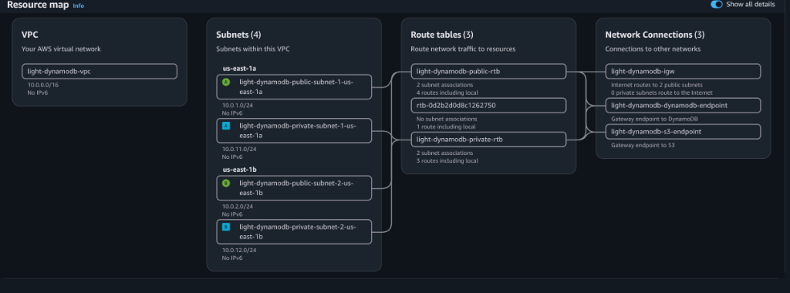
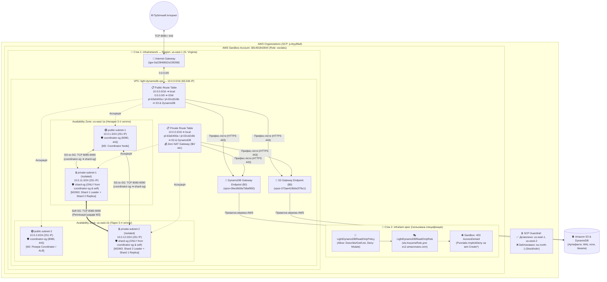

# Light-DynamoDB: Capstone Project (Milestone 1)

Проєкт із розбудови власного розподіленого шардованого Key-Value сховища (за зразком DynamoDB). У рамках **Milestone 1** ми налаштували базову хмарну мережу через Terraform (IaC), дослідили межі прав у пісочниці AWS Academy (`voclabs`), порахували квоти й бюджет на М2, провели рев'ю архітектури з ШІ-критиком (додали Gateway VPC Endpoints та SG-to-SG ізоляцію) та перевірили повну відтворюваність інфраструктури з нуля.

---

## 1. Схема мережі та архітектури (після AI Design Review)

### Жива карта ресурсів VPC у AWS Console (`us-east-1`):

> На карті видно: `light-dynamodb-igw` обслуговує виключно 2 публічні підмережі (**`0 private subnets route to the Internet`**), тоді як `light-dynamodb-private-rtb` має лише 3 внутрішні маршрути (`local` + безкоштовні Gateway Endpoints до S3 та DynamoDB).

### Повна архітектурна діаграма:




---

## 2. Структура репозиторію

```text
├── mermaid-diagram.svg                # Графічна схема архітектури та мережі
├── openspec/
│   └── m1-infra-setup.md              # OpenSpec пропозиція змін (Spec before code)
├── docs/
│   ├── adr/
│   │   ├── ADR.md                     # Початкові архітектурні рішення (до запуску)
│   │   ├── post-ADR.md                # Зміни після першого запуску в пісочниці + IAM-помилки
│   │   └── post-review-ADR.md         # Зміни після рев'ю ШІ-критика (Endpoints + SG-to-SG)
│   ├── ai-critique.md                 # Рев'ю архітектури від ШІ-критика
│   ├── labrole-dissection.md          # Task 1: Аналіз ролі voclabs / Pvoclabs
│   ├── quotas-and-finops.md           # Tasks 6 & 7: Ліміти квот і розрахунок бюджету M2
│   ├── control-questions.md           # Відповіді на контрольні питання для захисту
│   ├── vpc-resource-map.png           # Скріншот живої карти ресурсів VPC з AWS Console
│   └── recreatability-proof.log       # Task 8: Реальний лог тесту destroy/apply
├── infra/
│   ├── network/                       # Живий мережевий стек (VPC, Subnets, IGW, Endpoints, SGs)
│   │   ├── main.tf
│   │   ├── variables.tf
│   │   ├── outputs.tf
│   │   └── versions.tf
│   └── iam-spec/                      # Ізольований стек для Tasks 2 & 3 (Read-Only Policy + Role)
│       ├── main.tf
│       ├── variables.tf
│       └── versions.tf
└── scripts/
    ├── dissect_labrole.sh             # Скрипт перевірки ролі та прав через AWS CLI
    ├── check_quotas.sh                # Скрипт перевірки квот акаунта
    └── verify_recreatability.sh       # Скрипт автоматичного тесту відтворюваності
```

---

## 3. Як підняти інфраструктуру з нуля

### Крок 1. Налаштувати AWS CLI ключі з пісочниці
Скопіюй тимчасові ключі з вкладки **AWS Details** у файл `~/.aws/credentials` та переконайся, що в `~/.aws/config` вказано `region = us-east-1`:
```bash
aws sts get-caller-identity
```

### Крок 2. Розгорнути мережевий стек
```bash
cd infra/network
terraform init
terraform plan
terraform apply -auto-approve
```

### Крок 3. Перевірити ізольований стек IAM (Завдання 2 і 3)
Стек `infra/iam-spec` містить опис кастомної Read-Only політики та ролі. Валідація синтаксису проходить успішно, а спроба деплою наочно демонструє обмеження пісочниці (`403 AccessDenied` на `iam:CreatePolicy` та `iam:CreateRole`):
```bash
cd ../iam-spec
terraform init
terraform validate
terraform apply -auto-approve
```

---

## 4. Як перевірити створені ресурси

Після виконання `terraform apply` в `infra/network` можна перевірити створену мережу через AWS CLI:

```bash
VPC_ID=$(terraform -chdir=infra/network output -raw vpc_id)

# Перевірити створену VPC та налаштування DNS
aws ec2 describe-vpcs --vpc-ids "$VPC_ID" \
  --query "Vpcs[0].[VpcId,CidrBlock,EnableDnsHostnames,EnableDnsSupport]" --output table

# Перевірити всі 4 підмережі та розподіл по зонах us-east-1a / us-east-1b
aws ec2 describe-subnets --filters "Name=vpc-id,Values=$VPC_ID" \
  --query "Subnets[*].[SubnetId,CidrBlock,AvailabilityZone,MapPublicIpOnLaunch,Tags[?Key=='Name'].Value|[0]]" \
  --output table

# Перевірити таблиці маршрутизації (Public має IGW, Private — локальна + Gateway Endpoints)
aws ec2 describe-route-tables --filters "Name=vpc-id,Values=$VPC_ID" \
  --query "RouteTables[*].[RouteTableId,Routes[*].[DestinationCidrBlock,GatewayId,DestinationPrefixListId],Tags[?Key=='Name'].Value|[0]]" \
  --output json

# Перевірити створені Gateway VPC Endpoints (S3 та DynamoDB)
aws ec2 describe-vpc-endpoints --filters "Name=vpc-id,Values=$VPC_ID" \
  --query "VpcEndpoints[*].[VpcEndpointId,ServiceName,VpcEndpointType,State]" --output table
```

---

## 5. Перевірка відтворюваності (Task 8 — Recreatability Proof)

Для автоматичної перевірки повного циклу видалення та повторного підняття з нуля запускається скрипт:
```bash
./scripts/verify_recreatability.sh
```

### Фактичні результати запуску в Sandbox (`Account: 381491842844`):
- **Час видалення (`terraform destroy`)**: **13 секунд**
- **Час створення з нуля (`terraform apply`)**: **35 секунд**
- **Загальний час циклу**: **48 секунд**
- **Створені ресурси (16 шт.)**:
  - VPC: `vpc-02ce3170300d3c578` (`10.0.0.0/16`)
  - Internet Gateway: `igw-0a22846652e239268`
  - Public Subnets: `subnet-026d4905bae2aba57` (`10.0.1.0/24`), `subnet-0b8da1cb10b2a69b7` (`10.0.2.0/24`)
  - Private Subnets: `subnet-00cb92d7e1a78adb4` (`10.0.11.0/24`), `subnet-0a7f2c7396ad1e91e` (`10.0.12.0/24`)
  - Gateway VPC Endpoints: `vpce-073ae419b0e2f76c1` (S3), `vpce-09ec8b5fa758af950` (DynamoDB)
  - Security Groups: `sg-0c9cba306513c1aa8` (`coordinator-sg`), `sg-06b966c0acc31bd74` (`shard-sg`)
- **Історія еволюції архітектури**:
  - Перехід із `eu-north-1` у `us-east-1` через блокування SCP (`p-ktyy86af`) та розтин ролі `voclabs` описано у [`docs/adr/post-ADR.md`](docs/adr/post-ADR.md).
  - Додавання безкоштовних S3/DynamoDB Gateway Endpoints та перехід на SG-to-SG ізоляцію після рев'ю ШІ-критика описано у [`docs/adr/post-review-ADR.md`](docs/adr/post-review-ADR.md).
